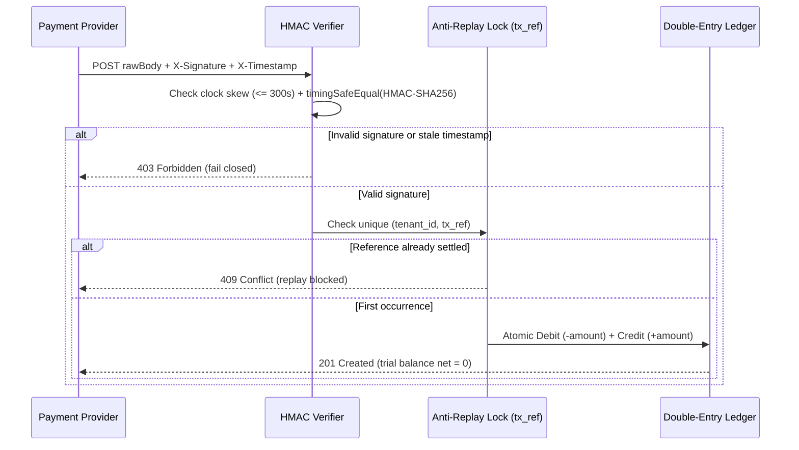

# zero-trust-webhook-ledger

 
[](LICENSE)

Zero-dependency Node.js module and PostgreSQL 17 `FORCE ROW LEVEL SECURITY` reference schema for verifying payment webhooks in constant time, blocking replay attacks with HTTP `409`, and settling funds in a strict zero-sum double-entry ledger.

## Why this exists

Payment integrations commonly break in three predictable ways: verifying parsed JSON instead of the raw request bytes, comparing HMAC signatures with `===` instead of constant-time byte comparison, and updating a single mutable `balance` column without a unique transaction lock. Replayed webhooks or edited payment screenshots then credit the same order twice.

This repository packages the defensive baseline cleanly with zero external runtime dependencies.

## Architecture



## Quick Start

Requires Node.js 20+. Zero packages to install.

```bash
git clone https://github.com/JARMID/zero-trust-webhook-ledger.git
cd zero-trust-webhook-ledger
npm test
```

## Usage

```javascript
import {
  signWebhookPayload,
  verifyWebhookSignature,
  DoubleEntryLedger,
} from "./src/index.mjs";

const secret = process.env.WEBHOOK_SECRET;
const rawBody = JSON.stringify({ tx_ref: "TX-882419", amount_minor: 150000 });
const ts = Math.floor(Date.now() / 1000);
const header = `sha256=${signWebhookPayload(rawBody, secret, ts)}`;

const check = verifyWebhookSignature({
  rawBody,
  signatureHeader: header,
  secret,
  timestampHeader: String(ts),
});

if (!check.ok) {
  throw new Error(`Rejected webhook: ${check.reason}`);
}

const ledger = new DoubleEntryLedger();
ledger.createAccount({ tenantId: "shop_01", accountId: "clearing", currency: "DZD", initialBalanceMinor: 500000 });
ledger.createAccount({ tenantId: "shop_01", accountId: "merchant", currency: "DZD", initialBalanceMinor: 0 });

const settlement = ledger.postTransfer({
  tenantId: "shop_01",
  txRef: "TX-882419",
  debitAccountId: "clearing",
  creditAccountId: "merchant",
  amountMinor: 150000,
  currency: "DZD",
});
// Second call with the same txRef returns { ok: false, status: 409, error: "duplicate_transaction_reference" }
```

## PostgreSQL Reference Schema

See [`sql/001_zero_trust_ledger_rls.sql`](sql/001_zero_trust_ledger_rls.sql) for the production table layout and stored procedure:

- Integer `BIGINT` minor units (`CHECK (balance_minor >= 0)`), avoiding floating-point rounding drift.
- Composite tenant foreign keys `(tenant_id, account_id)` and `(tenant_id, tx_ref)` plus unique receipt SHA-256 fingerprint constraint.
- `ENABLE ROW LEVEL SECURITY` paired with `FORCE ROW LEVEL SECURITY`, `NULLIF(current_setting('app.current_tenant_id', true), '')::uuid`, and `REVOKE INSERT, UPDATE, DELETE, TRUNCATE ... FROM PUBLIC`.
- `post_double_entry_transfer(...)` `SECURITY DEFINER` function (`SET search_path = pg_catalog, public`) locking both accounts in deterministic `ORDER BY id ASC FOR UPDATE` order.

## License

MIT © [Khalef Abdelmadjid (@JARMID)](https://github.com/JARMID)
